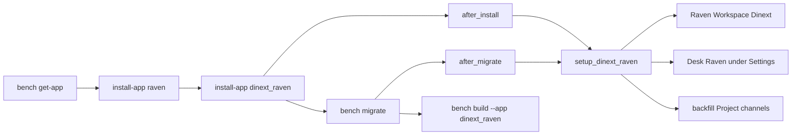
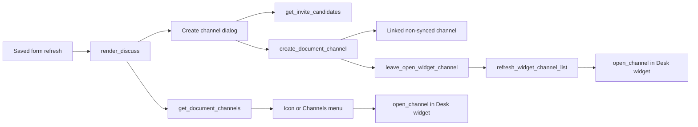
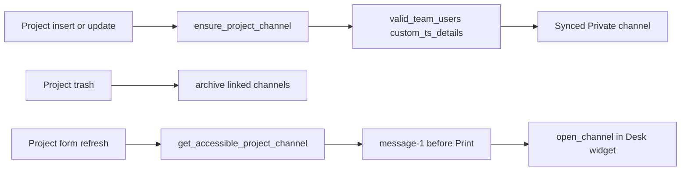

# Dinext Raven

`dinext_raven` — overlay Dinext над установленным приложением [Raven](https://github.com/The-Commit-Company/raven).
Кастомизации живут здесь; upstream `raven` остаётся отдельным приложением и не форкается.

Приложение ставится в существующий [Bench](https://github.com/frappe/bench) вместе с
`dinext_common` и `raven`. Оно переименовывает chat workspace в `Dinext`, вкладывает
Desk Workspace `Raven` под Settings, правит виджет чата на Desk и связывает каналы
с документами (в том числе один synced-канал на Project).

**GitLab:** https://dinext.gitlab.yandexcloud.net/erpnext/dinext/dinext-raven

Этот README — точка входа для установки и сопровождения. Общие agent-правила
Dinext не копируются сюда: см. [AGENTS.md](AGENTS.md).

## Содержание

- [Обзор и границы ответственности](#обзор-и-границы-ответственности)
- [Возможности](#возможности)
- [Установка](#установка)
- [Использование](#использование)
- [Технологии](#технологии)
- [Конфигурация](#конфигурация)
- [Требования](#требования)
- [Разработка и сопровождение](#разработка-и-сопровождение)
- [Документация](#документация)
- [Благодарности](#благодарности)
- [История изменений](#история-изменений)
- [Структура репозитория](#структура-репозитория)
- [Схема взаимодействия](#схема-взаимодействия)
- [Лицензия](#лицензия)

## 📖 Обзор и границы ответственности

На практике overlay делает следующее:

- после install/migrate приводит chat workspace к имени `Dinext` и ставит логотип
  Dinext;
- регистрирует Desk Workspace `Raven` как ребёнка Settings и карточку Settings Hub;
- держит виджет Raven на Desk без лишнего scroll страницы;
- создаёт и синхронизирует Private-канал проекта по составу команды;
- на сохранённых формах заменяет «Send a Raven» на Discuss и открывает каналы
  внутри виджета.

В экосистеме Dinext ответственность разделена так:

| Приложение | Ответственность |
| --- | --- |
| `raven` | Каналы, сообщения, виджет, роли `Raven User`, UI `/raven`. Overlay его не заменяет. |
| `dinext_common` | Desk-меню, Settings Hub, `configure_workspace_menu`, хук `dinext_settings_workspace_children`. |
| `dinext_raven` | Overlay: workspace, виджет, связанные каналы, Discuss, иконка на форме Project. |
| `dinext_projects` | Не required. Поле `Project.custom_ts_details` нужно для auto-канала проекта; без него Project-hooks — no-op. |

## ✨ Возможности

- Chat workspace `Raven` переименовывается или сливается в `Dinext`; логотип —
  `/assets/dinext_common/images/DI_SQ_NBG.png`. Desk Workspace `Raven` не
  переименовывается и не удаляется.
- Desk Workspace `Raven` остаётся видимым и вкладывается под Settings через
  hook `dinext_settings_workspace_children = ["Raven"]`.
- Карточка Settings Hub: workspace `Raven`, иконка `message-1`.
- Виджет: `.raven-chat` fixed, без `padding-bottom` у `.main-section`; свёрнутая
  полоса уже (2/3 ширины) и полупрозрачная; overflow скрыт.
- После SPA-навигации Desk сбрасывается scroll, прячутся stale `.page-container`,
  document overflow блокируется, если видимая страница помещается в viewport.
- Один synced Private-канал на Project: имя из title, workspace `Dinext`,
  участники из актуальных строк `custom_ts_details` (без `virtual_worker`,
  в окне `pt_valid_from` / `pt_valid_for`).
- Backfill каналов проектов на install/migrate; archive связанных каналов при
  trash Project; Cancel канал не архивирует.
- Discuss на timeline сохранённых документов (роль `Raven User` или Administrator):
  «Отправить в чат/канал», «Создать канал»; при одном канале — иконка, при
  нескольких — меню «Каналы».
- Создание связанного не-synced канала (Private / Public / Open) с invite только
  для пользователей, у которых уже есть отношение к документу.
- Иконка `message-1` на сохранённой форме Project сразу перед Print, если
  текущий пользователь — член synced неархивного канала и может его читать.
- Открытие канала раскрывает Desk-виджет и выбирает канал по отображаемому
  имени. Если виджета нет — alert, новая вкладка не открывается.
- Русские переводы видимых строк в `translations/ru.csv`, контекст `Dinext.Raven`.

## 🚀 Установка

`install-app dinext_raven` падает, если на сайте ещё нет `raven`.

```bash
cd /path/to/your/bench
bench get-app https://dinext.gitlab.yandexcloud.net/erpnext/dinext/dinext-raven.git --branch develop
bench --site your-site.local install-app raven
bench --site your-site.local install-app dinext_raven
bench --site your-site.local migrate
bench build --app dinext_raven
bench --site your-site.local clear-cache
```

После `after_install` и каждой `after_migrate` вызывается
`dinext_raven.setup.workspace.setup_dinext_raven`: rename/merge chat workspace,
логотип, nest Desk Raven, карточка Hub, backfill каналов проектов.

Тот же setup повторяет патч `dinext_raven.patches.v0_0.setup_dinext_raven`.

Ephemeral app CI клонирует upstream Raven с GitHub по SHA-pin в Control Center
`inventory/app-ci-dependencies.yaml`. Этот репозиторий — только overlay, не форк
Raven. Pin не добавляет Raven или `dinext_raven` в production-membership сайтов.

Если web-процесс запущен с Gunicorn `--preload`, после изменений Python
перезапустите web worker.

## 🛠️ Использование

### Chat workspace и Settings

После migrate:

- в Raven UI workspace называется `Dinext`, не `Raven`;
- Desk Workspace `Raven` виден под Settings (настройки, пользователи, боты,
  интеграции);
- на Settings Hub есть карточка «Raven».

Если на сайте уже есть и `Raven`, и `Dinext` как `Raven Workspace`, overlay
переносит каналы и членов в `Dinext` и удаляет дубль `Raven`.

### Виджет Desk

Глобальные assets из `hooks.py`:

- `public/css/dinext_raven.css`
- `public/js/dinext_raven_widget.js`
- `public/js/dinext_raven_discuss.js`

Виджет переносится в `document.body`, если Raven вставил его внутрь
`.main-section`. Свёрнутая полоса: ширина `2/3` от `--raven-content-width`
(по умолчанию 400px), opacity `0.7`, на hover/focus — `1`. Развёрнутый контейнер
ограничен `min(84vh, 100dvh - 48px)`.

### Discuss на форме

На сохранённом документе, который можно обсуждать, timeline показывает
`.dinext-raven-timeline-controls` вместо кнопки Send a Raven. Меню Discuss
и Channels — Desk `inner-group-button` (как grouped `add_inner_button`),
не самодельный `btn-group`.

`get_document_channels` отдаёт только неархивные связанные каналы, которые
текущий пользователь может открыть в виджете по правилам Raven (Private —
член канала, Public/Open — член chat workspace). Обход Administrator в
`frappe.has_permission` сюда не входит. 0/1/many на timeline считается по
этому списку. Discuss остаётся, даже если доступных каналов нет.

| Доступных каналов | UI |
| --- | --- |
| 0 | Только меню Discuss |
| 1 | Иконка канала + Discuss |
| 2+ | Меню Channels + Discuss |

Discuss:

- **Отправить в чат/канал** — клик по скрытой `.send-raven-button` (диалог
  upstream Raven);
- **Создать канал** — имя, тип, MultiSelect приглашённых из
  `get_invite_candidates`. После создания overlay сбрасывает кэш списка
  виджета (`frappe.raven_chat` remount) и сразу вызывает
  `dinext_raven.open_channel` для нового канала. Если в виджете уже открыт
  другой канал, overlay сначала выходит из него штатной кнопкой back, затем
  remount и открывает новый. Timeline Discuss/Channels перерисовывается в том
  же callback.

Клик по каналу вызывает `dinext_raven.open_channel`: раскрыть виджет, при
необходимости выйти из другого канала, выбрать строку списка по
`channel_name` / `name`. Таймаут 8 с. Если виджета нет (mobile /
`show_raven_on_desk` выкл.), overlay открывает `channel.route`
(`/raven/Dinext/<channel>`) в новой вкладке. Если виджет есть, но драйвер не
открыл канал, показывается alert без новой вкладки. `get_document_channels` и
`create_document_channel` отдают `route` вида `/raven/Dinext/<channel>`;
create дополнительно возвращает `channel_name` и `workspace`. Send и Create
принимают контекст документа без живой Form (`doctype` / `docname`).

Клиентский denylist Discuss: `DocShare`, `Version`, `Activity Log`,
`Error Log`, `Route History`, `Communication`, `Email Queue`, `Comment`,
`View Log`, `Access Log`, плюс DocType с префиксом `Raven `. Сервер дополнительно
отклоняет child-таблицы и остальные DocType `Raven *`. `File` разрешён.
Новый несохранённый документ Discuss не получает.

### Канал проекта

Hooks `Project.after_insert` / `on_update` → `ensure_project_channel`.
Нужны DocType `Project` и поле `custom_ts_details`. Иначе функция выходит.

На сохранённой форме Project scoped-скрипт
`public/js/dinext_raven_project_form.js` вызывает
`get_accessible_project_channel`. Иконка `message-1` («Открыть канал проекта»)
ставится перед Print, только если пользователь:

- имеет роль `Raven User` (или Administrator);
- читает Project;
- состоит в synced неархивном канале и читает `Raven Channel`.

На узкой ширине Desk Frappe прячет `.page-icon-group`;
`dinext_raven_project_form.css` оставляет видимой только эту иконку.

### Whitelisted API

| Метод | Назначение |
| --- | --- |
| `dinext_raven.document_channels.api.get_document_channels` | Связанные не-DM каналы документа и `route` |
| `dinext_raven.document_channels.api.get_invite_candidates` | Кандидаты invite: assignees, DocShare, пользователи с отношением к документу |
| `dinext_raven.document_channels.api.create_document_channel` | POST: связанный не-synced канал; члены = assignees + shares + session user + допустимые invitees; ответ `name`, `channel_name`, `workspace`, `route` |
| `dinext_raven.document_channels.api.get_accessible_project_channel` | Synced канал Project или `null`, если нет доступа |

Первые три метода требуют роль `Raven User` (или Administrator) и `read` на
документ. `create_document_channel` не делает канал synced и не подменяет
project-канал.

### Членство и DocShare

`ensure_raven_user` выдаёт роль `Raven User` и документ `Raven User`, затем
членство в workspace `Dinext`. Пользователи с Role Profile пропускаются с
предупреждением. Guest не добавляется.

Invite не создаёт DocShare «чужому». Если у assignee / уже связанного
пользователя нет `read`, overlay даёт только Read DocShare и не понижает
существующий share.

## 📦 Технологии

- **Backend:** Python 3.10+, Frappe Framework, Document ORM (без raw SQL).
- **Frontend:** JavaScript Desk (`frappe.ui.form`, `frappe.call`, виджет Raven).
- **Стили:** CSS assets; точечный inject во виджет для scroll-lock.
- **Сборка пакета:** `flit_core` в `pyproject.toml`.
- **Качество кода:** pre-commit (`ruff`, `eslint`, `prettier`, `pre-commit-hooks`).
- **CI:** include `/ci/dinext-app.yml` из `dinext_control_center` (`main`).

## 🔧 Конфигурация

Основная конфигурация — в [dinext_raven/hooks.py](dinext_raven/hooks.py).

Ключевые hooks:

- `required_apps = ["dinext_common", "raven"]`
- `app_include_css` / `app_include_js` — виджет и Discuss на всём Desk
- `doctype_js = {"Project": "public/js/dinext_raven_project_form.js"}`
- `after_install` / `after_migrate` → `dinext_raven.install`
- `doc_events.Project` → `document_channels.project`
- `dinext_settings_workspace_children = ["Raven"]`

Своих ключей `site_config.json` и переменных окружения приложение не объявляет.
CSS иконки Project подгружается через `frappe.require` на refresh формы, не
через `app_include_css`.

После правок frontend:

```bash
bench build --app dinext_raven
bench --site your-site.local clear-cache
```

После правок Python setup/каналов:

```bash
bench --site your-site.local migrate
```

## ✅ Требования

- [Bench](https://github.com/frappe/bench) с Frappe.
- Установленные `dinext_common` и `raven` **до** `dinext_raven`.
- Python `>=3.10` (`pyproject.toml`).
- Node.js для `bench build`.
- Совместимые версии Frappe / Raven поставки Dinext (в этом репозитории не
  закреплены).
- Для auto-канала проекта: DocType `Project` и таблица `custom_ts_details`
  (обычно `dinext_projects`).
- Роль `Raven User` у тех, кто обсуждает документы и открывает канал проекта.
- Для локальных проверок: pre-commit; Python-тесты на сайте с установленным Raven.

## 🤝 Разработка и сопровождение

Перед любым изменением пройдите обязательный OpenSpec lifecycle из
[AGENTS.md](AGENTS.md). Proposal, design, specs и tasks хранятся в Store
`dinext-docs` (`openspec/config.yaml` указывает `store: dinext-docs`).
Локальные `openspec/specs` и `openspec/changes` в этом репозитории не создаются.

```bash
cd apps/dinext_raven
pre-commit install
```

В репозитории: валидность JSON/TOML/YAML, ruff, prettier, eslint, базовая
гигиена. Markdown исключён из `trailing-whitespace`.

Python-тесты:

- [dinext_raven/tests/test_document_channels.py](dinext_raven/tests/test_document_channels.py)
- [dinext_raven/tests/test_translations.py](dinext_raven/tests/test_translations.py)

```bash
bench --site your-site.local run-tests --app dinext_raven
```

Не редактируйте исходники `raven` из этого overlay.

## 📄 Документация

- Документация продукта: [docs.dinext.ru](https://docs.dinext.ru)
- Navigation stub: [AGENTS.md](AGENTS.md)
- Hooks: [dinext_raven/hooks.py](dinext_raven/hooks.py)
- Install/migrate: [dinext_raven/install.py](dinext_raven/install.py)
- Workspace setup: [dinext_raven/setup/workspace.py](dinext_raven/setup/workspace.py)
- Каналы: [dinext_raven/document_channels/service.py](dinext_raven/document_channels/service.py)
- API: [dinext_raven/document_channels/api.py](dinext_raven/document_channels/api.py)
- Project hooks: [dinext_raven/document_channels/project.py](dinext_raven/document_channels/project.py)
- Виджет: [dinext_raven/public/js/dinext_raven_widget.js](dinext_raven/public/js/dinext_raven_widget.js)
- Discuss: [dinext_raven/public/js/dinext_raven_discuss.js](dinext_raven/public/js/dinext_raven_discuss.js)
- Форма Project: [dinext_raven/public/js/dinext_raven_project_form.js](dinext_raven/public/js/dinext_raven_project_form.js)
- Переводы: [dinext_raven/translations/ru.csv](dinext_raven/translations/ru.csv)
- Тесты: [dinext_raven/tests/](dinext_raven/tests/)
- Патч setup: [dinext_raven/patches/v0_0/setup_dinext_raven.py](dinext_raven/patches/v0_0/setup_dinext_raven.py)

## ❤️ Благодарности

- Dinext — брендинг, Desk-меню и Settings Hub
- [Raven](https://github.com/The-Commit-Company/raven) — The Commit Company
  (Algocode Technologies Pvt. Ltd.), AGPL-3.0
- Frappe Framework — роутинг Desk, формы, hooks, роли

## 📝 История изменений

Краткая сводка по текущему дереву. Полный журнал — в Git ветки поставки.
Даты коммитов здесь не выдумываются.

### Overlay workspace, виджет и каналы

- Chat workspace `Dinext`, логотип Dinext, Desk Raven под Settings и карточка Hub.
- Виджет без лишнего scroll Desk; свёрнутая полоса уже и полупрозрачная.
- Synced Private-канал Project, Discuss на формах, invite/DocShare-политика.
- Иконка канала на форме Project и открытие канала в виджете; без виджета — `/raven/...` в новой вкладке.

### Bootstrap overlay

- Пустой product overlay: `required_apps`, Gitflow `develop`, OpenSpec pointer,
  ephemeral CI pin Raven.

## 🗂️ Структура репозитория

```text
dinext_raven/
├── AGENTS.md                         # Navigation stub → dinext-docs
├── README.md                         # Этот документ
├── license.txt                       # Лицензия MIT overlay
├── pyproject.toml                    # Пакет, Python >=3.10, ruff
├── .pre-commit-config.yaml           # Локальные проверки
├── .gitlab-ci.yml                    # include dinext-app.yml
├── openspec/config.yaml              # Указатель на Store dinext-docs
└── dinext_raven/
    ├── hooks.py                      # required_apps, assets, events, install
    ├── install.py                    # after_install / after_migrate
    ├── modules.txt                   # Модуль Dinext Raven
    ├── patches.txt                   # setup_dinext_raven
    ├── patches/v0_0/                 # Повтор setup на migrate
    ├── setup/workspace.py            # Dinext workspace, nest, Hub
    ├── document_channels/            # Сервис, API, Project hooks
    ├── public/css/                   # Виджет и форма Project
    ├── public/js/                    # Виджет, Discuss, Project toolbar
    ├── translations/ru.csv           # Русские строки
    └── tests/                        # Каналы и переводы
```

Основные части:

- `dinext_raven/hooks.py` — зависимости, Desk assets, Project events.
- `dinext_raven/setup/workspace.py` — rename/merge `Raven Workspace`, логотип,
  nest, Hub.
- `dinext_raven/document_channels/service.py` — создание канала, члены,
  DocShare, denylist.
- `dinext_raven/public/js/dinext_raven_discuss.js` — Discuss и драйвер виджета.
- `openspec/config.yaml` — pointer на Store; не дублирует specs/changes.

## 🔗 Схема взаимодействия

Bench читает `hooks.py`. Install/migrate настраивают workspace и backfill.
Формы и иконка Project ходят в whitelist API; открытие канала идёт через виджет.

### Установка и миграция



### Discuss и создание канала



### Project: sync и иконка



## 📜 Лицензия

Overlay — MIT. Текст: [license.txt](license.txt).

Upstream Raven — AGPL-3.0 (The Commit Company). Overlay не перелицензирует Raven.
