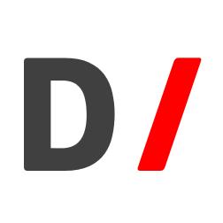
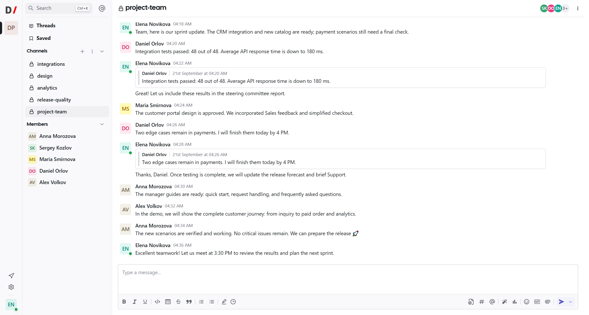
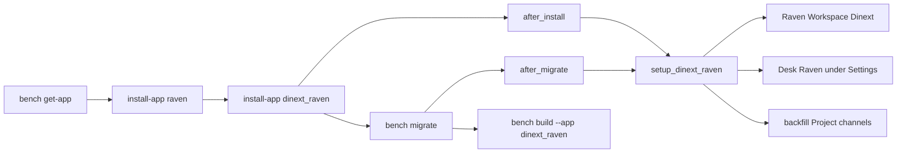
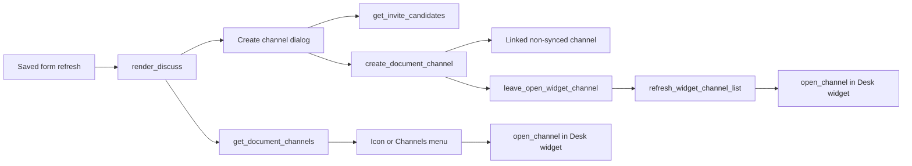
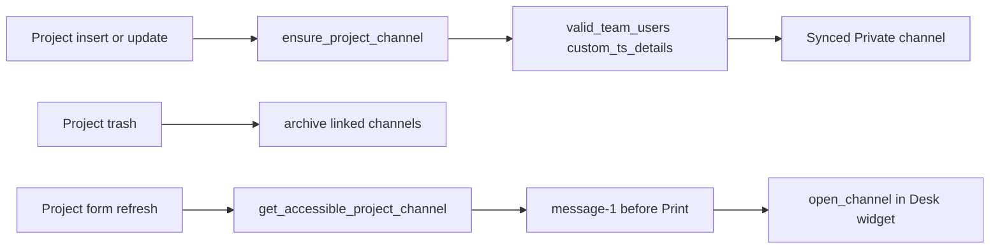

[Русский](README.ru.md)

<!-- dinext-presentation:start -->
<p align="center">
  <a href="https://dinext.ru"></a>
</p>
<h1 align="center">Dinext Raven</h1>

<hr>

<p align="center">Project and document conversations in Dinext, with synchronized team channels and an integrated chat widget.</p>

<p align="center">
  
</p>
<p align="center"><sub>A project-team conversation with fictional demonstration participants.</sub></p>

<p align="center">
  <a href="https://dinext.ru">Website</a> · <a href="https://docs.dinext.ru">Documentation</a>
</p>
<!-- dinext-presentation:end -->

# Dinext Raven

`dinext_raven` is a Dinext overlay on the installed [Raven](https://github.com/The-Commit-Company/raven) application.
Customizations live here; upstream `raven` remains a separate application and is not forked.

The application is installed into an existing [Bench](https://github.com/frappe/bench) together with
`dinext_common` and `raven`. It renames the chat workspace to `Dinext`, nests
the `Raven` Desk Workspace under Settings, adjusts the Desk chat widget and links channels
to documents (including one synced channel per Project).

**GitLab:** https://dinext.gitlab.yandexcloud.net/erpnext/dinext/dinext-raven

This README is the entry point for installation and maintenance. Common Dinext agent rules
are not copied here: see [AGENTS.md](AGENTS.md).

## Contents

- [Overview and responsibilities](#-overview-and-responsibilities)
- [Features](#-features)
- [Installation](#-installation)
- [Usage](#-usage)
- [Technologies](#-technologies)
- [Configuration](#-configuration)
- [Requirements](#-requirements)
- [Development and maintenance](#-development-and-maintenance)
- [Documentation](#-documentation)
- [Changelog](#-changelog)
- [Repository structure](#-repository-structure)
- [Interaction diagram](#-interaction-diagram)
- [License](#-license)

## 📖 Overview and responsibilities

In practice, the overlay does the following:

- after install/migrate, sets the chat workspace name to `Dinext` and applies the logo
  Dinext;
- registers the `Raven` Desk Workspace as a Settings child and adds a Settings Hub card;
- keeps the Raven widget on Desk without unnecessary page scrolling;
- creates and synchronizes a project's Private channel based on team membership;
- replaces Send a Raven with Discuss on saved forms and opens channels
  inside the widget.

Responsibilities are divided in the Dinext ecosystem as follows:

| Application | Responsibility |
| --- | --- |
| `raven` | Channels, messages, widget, `Raven User` roles, `/raven` UI. The overlay does not replace it. |
| `dinext_common` | Desk menus, Settings Hub, `configure_workspace_menu`, the `dinext_settings_workspace_children` hook. |
| `dinext_raven` | Overlay: workspace, widget, linked channels, Discuss, Project form icon. |
| `dinext_projects` | Not required. The `Project.custom_ts_details` field is needed for the automatic project channel; without it, Project hooks are no-ops. |

## ✨ Features

- The `Raven` chat workspace is renamed or merged into `Dinext`; the logo is
  `/assets/dinext_common/images/DI_SQ_NBG.png`. The `Raven` Desk Workspace is neither
  renamed nor deleted.
- The `Raven` Desk Workspace remains visible and is nested under Settings through
  hook `dinext_settings_workspace_children = ["Raven"]`.
- Settings Hub card: workspace `Raven`, icon `message-1`.
- Widget: on Raven 3.0, the overlay mounts `.raven-chat` on Desk itself (`Raven User`
  role, chat enabled in Raven settings, not mobile) if upstream has not
  created it. The host is fixed, without `.main-section` `padding-bottom`; the collapsed
  bar is narrower (2/3 width) and translucent; overflow is hidden. The bar can be
  dragged along the bottom edge when collapsed or expanded, and the browser remembers
  its place. The `raven` source is not edited for this.
- After Desk SPA navigation, scroll is reset, stale `.page-container` elements are hidden,
  and document overflow is locked when the visible page fits in the viewport.
- One synced Private channel per Project: name from the title, workspace `Dinext`,
  members from current `custom_ts_details` rows (excluding `virtual_worker`,
  within the `pt_valid_from` / `pt_valid_for` window).
- Project channel backfill on install/migrate; linked channels are archived when
  Project is trashed; Cancel does not archive the channel.
- Discuss on the timeline of saved documents (`Raven User` role or Administrator):
  Send to Chat/Channel and Create Channel; one channel produces an icon,
  multiple channels produce a Channels menu.
- Creation of a linked non-synced channel (Private / Public / Open), with invitations limited
  to users who already have a relationship with the document.
- A `message-1` icon on a saved Project form immediately before Print, if
  the current user belongs to the synced, non-archived channel and can read it.
- Opening a channel expands the Desk widget and selects the channel by its display
  name. If there is no widget, an alert is shown and no new tab opens.
- Russian translations of visible strings in `translations/ru.csv`, context `Dinext.Raven`.

## 🚀 Installation

`install-app dinext_raven` fails if the site does not yet have `raven`.

```bash
cd /path/to/your/bench
bench get-app https://dinext.gitlab.yandexcloud.net/erpnext/dinext/dinext-raven.git --branch develop
bench --site your-site.local install-app raven
bench --site your-site.local install-app dinext_raven
bench --site your-site.local migrate
bench build --app dinext_raven
bench --site your-site.local clear-cache
```

After `after_install` and each `after_migrate`, the following is called:
`dinext_raven.setup.workspace.setup_dinext_raven`: rename/merge chat workspace,
logo, Desk Raven nesting, Hub card, project channel backfill.

The same setup is repeated by the `dinext_raven.patches.v0_0.setup_dinext_raven` patch.

Ephemeral app CI clones upstream Raven from GitHub using a pinned SHA. This repository is only an overlay, not a fork
of Raven. The pin does not add Raven or `dinext_raven` to sites' production membership.

If the web process runs with Gunicorn `--preload`, restart the web worker after
Python changes.

## 🛠️ Usage

### Chat workspace and Settings

After migrate:

- in the Raven UI, the workspace is called `Dinext`, not `Raven`;
- the `Raven` Desk Workspace is visible under Settings (settings, users, bots,
  integrations);
- Settings Hub has a Raven card.

If both `Raven` and `Dinext` already exist on the site as `Raven Workspace` records, the overlay
moves channels and members into `Dinext` and deletes the duplicate `Raven`.

### Desk widget

Global assets from `hooks.py`:

- `public/css/dinext_raven.css`
- `public/js/dinext_raven_widget.js`
- `public/js/dinext_raven_discuss.js`

The widget moves to `document.body` if Raven inserted it inside
`.main-section`. The collapsed bar is `2/3` of `--raven-content-width`
(400px by default), with opacity `0.7`, rising to `1` on hover/focus. The expanded container
is limited to `min(84vh, 100dvh - 48px)`. The bar can be dragged along the bottom
edge when collapsed or expanded; the browser remembers its place.

### Discuss on the form

On a saved document that supports discussion, the timeline shows
`.dinext-raven-timeline-controls` instead of the Send a Raven button. Discuss
and Channels menus are Desk `inner-group-button` controls (like grouped `add_inner_button`),
rather than a custom `btn-group`.

`get_document_channels` returns only non-archived linked channels that
the current user can open in the widget under Raven's rules (Private —
channel member; Public/Open — chat workspace member). The Administrator bypass in
`frappe.has_permission` does not apply here. The timeline's 0/1/many count uses
this list. Discuss remains available even if there are no accessible channels.

| Accessible channels | UI |
| --- | --- |
| 0 | Discuss menu only |
| 1 | Channel icon + Discuss |
| 2+ | Channels menu + Discuss |

Discuss:

- **Send to Chat/Channel** — clicks the hidden `.send-raven-button` (dialog
  upstream Raven);
- **Create Channel** — name, type, MultiSelect invitees from
  `get_invite_candidates`. After creation, the overlay clears the widget's list cache
  (remounting `frappe.raven_chat`) and immediately calls
  `dinext_raven.open_channel` for the new channel. If another channel is already open
  in the widget, the overlay first leaves it through the standard back button, then
  remounts and opens the new one. Timeline Discuss/Channels controls are redrawn in the
  same callback.

Clicking a channel calls `dinext_raven.open_channel`: expand the widget, leave
another channel if necessary, and select the list row by
`channel_name` / `name`. Timeout: 8 seconds. If the widget is absent (mobile /
`show_raven_on_desk` off), the overlay opens `channel.route`
(`/raven/Dinext/<channel>`) in a new tab. If the widget exists but the driver did not
open the channel, an alert appears without a new tab. `get_document_channels` and
`create_document_channel` return a `route` in the form `/raven/Dinext/<channel>`;
create additionally returns `channel_name` and `workspace`. Send and Create
accept document context without a live Form (`doctype` / `docname`).

Client-side Discuss denylist: `DocShare`, `Version`, `Activity Log`,
`Error Log`, `Route History`, `Communication`, `Email Queue`, `Comment`,
`View Log`, `Access Log`, plus DocTypes prefixed with `Raven `. The server additionally
rejects child tables and other `Raven *` DocTypes. `File` is allowed.
A new, unsaved document does not receive Discuss controls.

### Project channel

Hooks `Project.after_insert` / `on_update` → `ensure_project_channel`.
The `Project` DocType and `custom_ts_details` field are required. Otherwise, the function exits.

On a saved Project form, the scoped script
`public/js/dinext_raven_project_form.js` calls
`get_accessible_project_channel`. The `message-1` icon (Open Project Channel)
is placed before Print only if the user:

- has the `Raven User` role (or is Administrator);
- can read Project;
- belongs to the synced, non-archived channel and can read `Raven Channel`.

At narrow Desk widths, Frappe hides `.page-icon-group`;
`dinext_raven_project_form.css` keeps only this icon visible.

### Whitelisted API

| Method | Purpose |
| --- | --- |
| `dinext_raven.document_channels.api.get_document_channels` | Document's linked non-DM channels and `route` |
| `dinext_raven.document_channels.api.get_invite_candidates` | Invitation candidates: assignees, DocShare, users related to the document |
| `dinext_raven.document_channels.api.create_document_channel` | POST: linked non-synced channel; members = assignees + shares + session user + permitted invitees; response: `name`, `channel_name`, `workspace`, `route` |
| `dinext_raven.document_channels.api.get_accessible_project_channel` | Synced Project channel, or `null` if access is unavailable |

The first three methods require the `Raven User` role (or Administrator) and `read` permission on
the document. `create_document_channel` does not make the channel synced and does not replace
the project channel.

### Membership and DocShare

`ensure_raven_user` grants the `Raven User` role and a `Raven User` document, then
membership in the `Dinext` workspace. Users with a Role Profile are skipped with a
warning. Guest is not added.

Invitations do not create DocShare for an unrelated user. If an assignee / already related
user lacks `read`, the overlay grants only Read DocShare and does not downgrade
an existing share.

## 📦 Technologies

- **Backend:** Python 3.10+, Frappe Framework, Document ORM (without raw SQL).
- **Frontend:** Desk JavaScript (`frappe.ui.form`, `frappe.call`, Raven widget).
- **Styles:** CSS assets; targeted injection into the widget for scroll locking.
- **Package build:** `flit_core` in `pyproject.toml`.
- **Code quality:** pre-commit (`ruff`, `eslint`, `prettier`, `pre-commit-hooks`).

## 🔧 Configuration

The main configuration is in [dinext_raven/hooks.py](dinext_raven/hooks.py).

Key hooks:

- `required_apps = ["dinext_common", "raven"]`
- `app_include_css` / `app_include_js` — widget and Discuss throughout Desk
- `doctype_js = {"Project": "public/js/dinext_raven_project_form.js"}`
- `after_install` / `after_migrate` → `dinext_raven.install`
- `doc_events.Project` → `document_channels.project`
- `dinext_settings_workspace_children = ["Raven"]`

The application declares no custom `site_config.json` keys or environment variables.
Project icon CSS is loaded through `frappe.require` on form refresh, rather than
through `app_include_css`.

After frontend changes:

```bash
bench build --app dinext_raven
bench --site your-site.local clear-cache
```

After Python setup/channel changes:

```bash
bench --site your-site.local migrate
```

## ✅ Requirements

- [Bench](https://github.com/frappe/bench) with Frappe.
- `dinext_common` and `raven` installed **before** `dinext_raven`.
- Python `>=3.10` (`pyproject.toml`).
- Node.js for `bench build`.
- Raven 3.0.0 from a clean upstream checkout. This repository does not patch `raven`.
- For the automatic project channel: the `Project` DocType and `custom_ts_details` table
  (usually `dinext_projects`).
- The `Raven User` role for users who discuss documents and open a project channel.
- For local checks: pre-commit; Python tests on a site with Raven installed.

## 🤝 Development and maintenance

Before any change, follow the mandatory OpenSpec lifecycle in
[AGENTS.md](AGENTS.md).
Local `openspec/specs` and `openspec/changes` directories are not created in this repository.

```bash
cd apps/dinext_raven
pre-commit install
```

The repository includes JSON/TOML/YAML validity checks, ruff, prettier, eslint and basic
hygiene checks. Markdown is excluded from `trailing-whitespace`.

Python tests:

- [dinext_raven/tests/test_document_channels.py](dinext_raven/tests/test_document_channels.py)
- [dinext_raven/tests/test_translations.py](dinext_raven/tests/test_translations.py)

```bash
bench --site your-site.local run-tests --app dinext_raven
```

Do not edit the `raven` source from this overlay.

## 📄 Documentation

- Product documentation: [docs.dinext.ru](https://docs.dinext.ru)
- Navigation stub: [AGENTS.md](AGENTS.md)
- Hooks: [dinext_raven/hooks.py](dinext_raven/hooks.py)
- Install/migrate: [dinext_raven/install.py](dinext_raven/install.py)
- Workspace setup: [dinext_raven/setup/workspace.py](dinext_raven/setup/workspace.py)
- Channels: [dinext_raven/document_channels/service.py](dinext_raven/document_channels/service.py)
- API: [dinext_raven/document_channels/api.py](dinext_raven/document_channels/api.py)
- Project hooks: [dinext_raven/document_channels/project.py](dinext_raven/document_channels/project.py)
- Widget: [dinext_raven/public/js/dinext_raven_widget.js](dinext_raven/public/js/dinext_raven_widget.js)
- Discuss: [dinext_raven/public/js/dinext_raven_discuss.js](dinext_raven/public/js/dinext_raven_discuss.js)
- Project form: [dinext_raven/public/js/dinext_raven_project_form.js](dinext_raven/public/js/dinext_raven_project_form.js)
- Translations: [dinext_raven/translations/ru.csv](dinext_raven/translations/ru.csv)
- Tests: [dinext_raven/tests/](dinext_raven/tests/)
- Setup patch: [dinext_raven/patches/v0_0/setup_dinext_raven.py](dinext_raven/patches/v0_0/setup_dinext_raven.py)

## 📝 Changelog

A brief summary of the current tree. The full log is in the distribution branch's Git history.
Commit dates are not invented here.

### Raven 3.0

- Bench uses unmodified Raven 3.0.0. The Desk widget is provided by the overlay.

### Workspace overlay, widget and channels

- `Dinext` chat workspace, Dinext logo, Desk Raven under Settings and a Hub card.
- Widget without unnecessary Desk scrolling; a narrower, translucent collapsed bar that can be dragged along the bottom edge.
- Synced Private Project channel, Discuss on forms, invitation/DocShare policy.
- Project form channel icon and channel opening in the widget; without the widget, `/raven/...` opens in a new tab.

### Bootstrap overlay

- Empty product overlay: `required_apps`, Gitflow `develop`, OpenSpec pointer,
  ephemeral CI pin Raven.

## 🗂️ Repository structure

```text
dinext_raven/
├── AGENTS.md                         # Agent instructions
├── README.md                         # This document
├── license.txt                       # GPL-3 overlay license
├── pyproject.toml                    # Package, Python >=3.10, ruff
├── .pre-commit-config.yaml           # Local checks
├── .gitlab-ci.yml                    # include dinext-app.yml
├── openspec/config.yaml              # OpenSpec configuration
└── dinext_raven/
    ├── hooks.py                      # required_apps, assets, events, install
    ├── install.py                    # after_install / after_migrate
    ├── modules.txt                   # Dinext Raven module
    ├── patches.txt                   # setup_dinext_raven
    ├── patches/v0_0/                 # Repeat setup on migrate
    ├── setup/workspace.py            # Dinext workspace, nest, Hub
    ├── document_channels/            # Service, API, Project hooks
    ├── public/css/                   # Widget and Project form
    ├── public/js/                    # Widget, Discuss, Project toolbar
    ├── translations/ru.csv           # Russian strings
    └── tests/                        # Channels and translations
```

Main components:

- `dinext_raven/hooks.py` — dependencies, Desk assets, Project events.
- `dinext_raven/setup/workspace.py` — `Raven Workspace` rename/merge, logo,
  nest, Hub.
- `dinext_raven/document_channels/service.py` — channel creation, members,
  DocShare, denylist.
- `dinext_raven/public/js/dinext_raven_discuss.js` — Discuss and widget driver.
- `openspec/config.yaml` — Store pointer; does not duplicate specs/changes.

## 🔗 Interaction diagram

Bench reads `hooks.py`. Install/migrate configures the workspace and backfill.
Forms and the Project icon use the whitelisted API; channels open through the widget.

### Installation and migration



### Discuss and channel creation



### Project: sync and icon



## 📜 License

The overlay is GNU GPL v3. Text: [license.txt](license.txt).

Upstream Raven is AGPL-3.0 (The Commit Company). The overlay does not relicense Raven.
